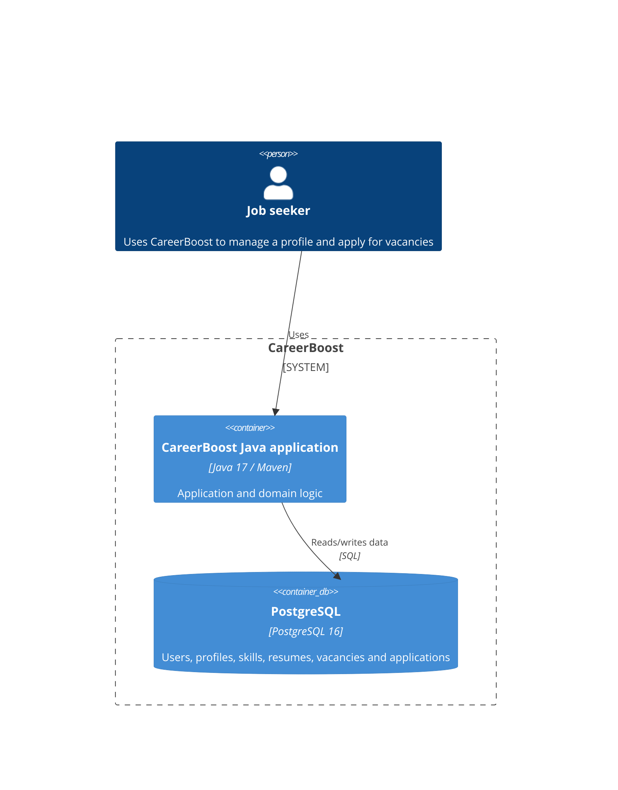

# CareerBoost architecture

## Architectural style and layers

The project uses a layered architecture. Dependencies should point inward toward the domain/business rules.

1. **Presentation layer** — CLI/API controllers; receives requests and returns responses.
2. **Application layer** — use cases and orchestration (registration, profile editing, resume creation, applications).
3. **Domain layer** — core entities and business rules (User, Profile, Skill, Resume, Vacancy, Application).
4. **Infrastructure layer** — PostgreSQL repositories, external integrations, configuration and logging.

## C4 Container diagram

## Runtime

Docker Compose starts the Java application container and PostgreSQL database. The initial schema is mounted into PostgreSQL's initialization directory and is applied when the database volume is first created.
