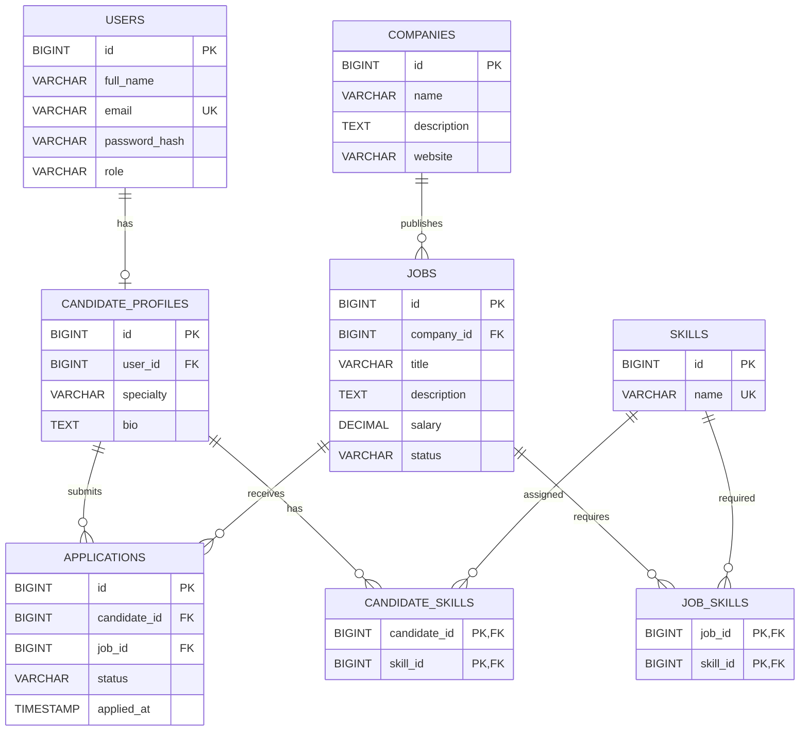

# CareerBoost ER-диаграммасы

## Байланыстар
- `companies` 1:N `jobs` — бір компания бірнеше вакансия жариялайды.
- `candidate_profiles` 1:N `applications` — бір кандидат бірнеше өтінім жібере алады.
- `jobs` 1:N `applications` — бір вакансияға бірнеше өтінім түсе алады.
- `candidate_profiles` M:N `skills` — кандидатта бірнеше дағды, бір дағды бірнеше кандидатта болуы мүмкін.
- `jobs` M:N `skills` — вакансия бірнеше дағды талап етеді, бір дағды бірнеше вакансияда кездеседі.
- `users` 1:0..1 `candidate_profiles` — пайдаланушының кандидат профилі болуы мүмкін.
