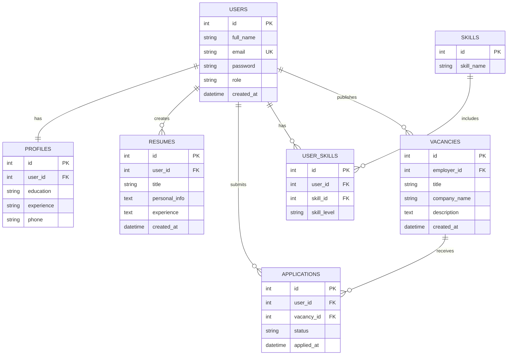

# CareerBoost — ER-диаграмма

**Жоба тақырыбы:** Түйіндеме конструкторы бар мансаптық портал (CareerBoost).

Бұл ER-диаграммада 7 негізгі субъект және олардың арасындағы 1:1, 1:N және M:N байланыстары көрсетілген.

## 1. Субъектілер

| № | Субъект | Мақсаты |
|---|---|---|
| 1 | Users | Пайдаланушылар мен жұмыс берушілер туралы мәліметтер |
| 2 | Profiles | Пайдаланушының жеке профилі |
| 3 | Skills | Дағдылар анықтамалығы |
| 4 | User_Skills | Пайдаланушылар мен дағдылар арасындағы байланыс |
| 5 | Resumes | Пайдаланушы түйіндемелері |
| 6 | Vacancies | Жұмыс берушілер жариялаған вакансиялар |
| 7 | Applications | Жұмыс орындарына жіберілген өтінімдер |

## 2. ER-диаграмма

## 3. Байланыстар

- **Users — Profiles (1:1):** әр пайдаланушының бір профилі болады.
- **Users — Resumes (1:N):** бір пайдаланушы бірнеше түйіндеме жасай алады.
- **Users — Applications (1:N):** бір пайдаланушы бірнеше өтінім жібере алады.
- **Users — Vacancies (1:N):** жұмыс беруші бірнеше вакансия жариялай алады.
- **Users — Skills (M:N):** байланыс аралық `User_Skills` кестесі арқылы жүзеге асады.
- **Vacancies — Applications (1:N):** бір вакансияға бірнеше өтінім түсе алады.

## 4. Кілттер

- **PK (Primary Key)** — кестедегі жазбаның бірегей бастапқы кілті.
- **FK (Foreign Key)** — басқа кестенің бастапқы кілтіне сілтеме.
- **UK (Unique Key)** — қайталанбайтын мән; бұл жерде email.

**Ескерту:** `VACANCIES.employer_id` өрісі жұмыс берушінің `USERS.id` мәніне сілтеме жасайды. Жұмыс беруші мен жұмыс іздеуші `USERS.role` өрісі арқылы ажыратылады.

## 5. Қорытынды

CareerBoost жобасының дерекқорында 7 субъект қарастырылған. Құрылым пайдаланушыларды, профильдерді, дағдыларды, түйіндемелерді, вакансияларды және өтінімдерді сақтауға арналған.
